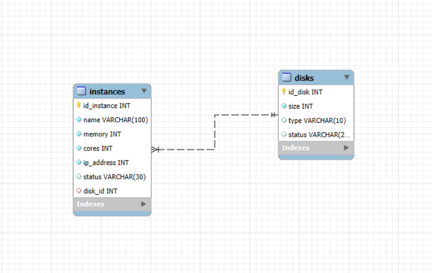
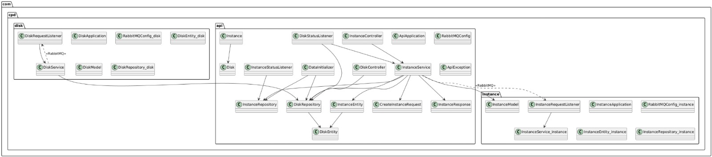

# PracticaCPD

# Nombre de la aplicación: Aplicación CPD

## Integrantes: 
| Name | Email | Github |
|-----------|-----------|-----------|
| Marco Cerejido Gutiérrez | m.cerejido.2022@alumnos.urjc.es | [MarcoCerejido](https://github.com/MarcoCerejido) |             |
| Victor Cortinas Ruiz | v.cortinas.2022@alumnos.urjc.es | [Corti23](https://github.com/Corti23)                             |
| Gonzalo de la Casa Paredes | g.delacasa.@alumnos.urjc.es | [GonzaloCasaParedes](https://github.com/GonzaloCasaParedes) 		| 		
| Alejandro Olías Núñez | a.oliasn.2022@alumnos.urjc.es | [Alejandro-ON](https://github.com/Alejandro-ON) |             |                     

## Herramienta de coordinación del equipo: 
[Tablero de GitHub](https://github.com/Corti23/PracticaCPD/issues)

## Capturas de pantalla: 

- **Página Principal:** 

 
 

**Descripción:** En la parte superior de la página se encuentra un formulario para crear Instancias.

Debajo se encuentran una tabla con el listado de Instancias que hay creadas, las cuales se pueden eliminar si el administrador lo desea.

Por último aparece una tabla con el listado de Discos que hay creados, al igual que las Instancias se pueden eliminar si el administrador lo desea y el estado del disco sea UNASSIGNED.

## Diagrama con las entidades de la base de datos: 
 

## Diagrama de clases: 
 

## Instrucciones de ejecución de la aplicación dockerizada
- Instalar docker (y docker-compose en caso de mac y linux).
- Abrir una consola de comandos.
- Moverse al directorio en el que se encuentra el proyecto (clonarlo previamente si es necesario: git clone https://github.com/Corti23/PracticaCPD.git).
- Para establecer la conexión con el contenedor, ejecutar el comando: docker-compose up
- Acceder a la página en el navegador mediante la url: http://localhost
- Para cerrar la conexión con el contenedor presione Ctrl+C y una vez se paren todos, Ctrl+Z para volver al directorio donde se encuentra el proyecto.

## Documentación para construcción de la imagen docker de cada Servicio
  - Construir imagen dockerizada:
  - Instalar docker.
  - Abrir una consola de comandos.
  - Moverse al directorio en el que se encuentra el proyecto (clonarlo previamente si es necesario: git clone https://github.com/Corti23/PracticaCPD.git).
  - Moverse al directorio en el que se encuentra el Servicio api, con el comando: “cd api”
  - Ejecutar el comando: “docker build -t victorcortinas/api .”
  - Ejecutar el comando: “docker push victorcortinas/api”
  - Volver al directorio en el que se encuentra el proyecto, con el comando: “cd ..”

  - Moverse al directorio en el que se encuentra el Servicio disk, con el comando: “cd disk”
  - Ejecutar el comando: “docker build -t victorcortinas/disk .”
  - Ejecutar el comando: “docker push victorcortinas/disk“
  - Volver al directorio en el que se encuentra el proyecto, con el comando: “cd ..”

  - Moverse al directorio en el que se encuentra el Servicio instance, con el comando: “cd instance”
  - Ejecutar el comando: “docker build -t victorcortinas/instance .”
  - Ejecutar el comando: “docker push victorcortinas/instance“
  - Volver al directorio en el que se encuentra el proyecto, con el comando: “cd ..”

## Uso de POSTMAN
### Requisitos previos a POSTMAN
 - Hay que tener el proyecto corriendo en Docker Compose como ya sabemos con el comando “docker-compose up”.
 - Hay que tener POSTMAN instalado en tu equipo.

### Paso 1: Importar la colección

1. Abre Postman
2. Haz clic en **"Import"** (Debajo de Explore)
3. Selecciona el archivo: `api.postman_collection.json`
4. Verás aparecer una colección llamada **"CPD API"**

---

### Orden recomendado de pruebas

Asegúrate de que tu entorno esté funcionando correctamente ejecutando los siguientes endpoints en orden, en todos los endpoints en los cuales se necesite una ID, es necesario copiarla previamente y pegarla antes de ejecutar el endpoint, por ejemplo, si quieres ver una instancia por ID, primero tendrías que listar todas o crear una nueva, copiar el ID y pegarlo en la URL de endpoint ver una instancia por ID sustituyendo la variable {id} por el ID que has copiado:

#### 1. Ver todos los discos
- **Método:** `GET`
- **URL:** `http://localhost/disks`

---

#### 2. Ver todas las instancias
- **Método:** `GET`
- **URL:** `http://localhost/instances`

---

#### 3. Ver un disco por ID
- **Método:** `GET`
- **URL:** `http://localhost/disks/{id}`

---

#### 4. Ver una instancia por ID
- **Método:** `GET`
- **URL:** `http://localhost/instances/{id}`

---

#### 5. Eliminar un disco por ID (solo si su estado es `UNASSIGNED`)
- **Método:** `DELETE`
- **URL:** `http://localhost/disks/{id}`

---

#### 6. Eliminar una instancia por ID
- **Método:** `DELETE`
- **URL:** `http://localhost/instances/{id}`

---

#### 7. Crear una instancia
- **Método:** `POST`
- **URL:** `http://localhost/instances`
- **Body (JSON):**
```json
{
    "name": "Test",
    "memory": 8,
    "cores": 4,
    "diskSize": 50,
    "diskType": "HDD"
}
```
---

#### 8. Crear un disco
- **Método:** `POST`
- **URL:** `http://localhost/disks`
- **Body (JSON):**
```json
{
  "size": 100,
  "type": "SSD"
}
```
### Consejos extra

- Después de cada `POST`, hay que esperar unos segundos e ir haciendo `GET` cada pocos segundos para comprobar los cambios que se realizan en los estados (`status`) de los Disk y de las Instances.
- Puedes usar [http://localhost:15672](http://localhost:15672) para ver el estado de RabbitMQ.
  - Usuario: `guest`
  - Contraseña: `guest`

---

## Participación
- **<span style="color:green">Marco Cerejido </span>:** 
    - Tareas: entidades, modelos, archivos de configuración, y DTOs
     - 5 commits más significativos:
       - [Commit 1](https://github.com/Corti23/PracticaCPD/commit/709580395e8509202fff7dc1b8b664dc88ced8c0)
       - [Commit 2](https://github.com/Corti23/PracticaCPD/commit/e134d2e90b844994305a8eb40d138a212f65fa09)
       - [Commit 3](https://github.com/Corti23/PracticaCPD/commit/61e828574edd589c6f89f22f2550e1862f5bc41b)
       - [Commit 4](https://github.com/Corti23/PracticaCPD/commit/57134f7cb348089dad938ad7380551ab74cedc15)
       - [Commit 5](https://github.com/Corti23/PracticaCPD/commit/7933de8aa3447e32006ba1bf1debad0b32139db7)
    - 5 ficheros en los que se ha participado:
      - [haproxy.cfg](https://github.com/Corti23/PracticaCPD/blob/main/haproxy.cfg)
      - [InstanceResponse.java](https://github.com/Corti23/PracticaCPD/blob/main/api/src/main/java/com/cpd/api/dto/InstanceResponse.java)
      - [CreateInstanceRequest.java](https://github.com/Corti23/PracticaCPD/blob/main/api/src/main/java/com/cpd/api/dto/CreateInstanceRequest.java)
      - [Instance.java](https://github.com/Corti23/PracticaCPD/blob/main/api/src/main/java/com/cpd/api/model/Instance.java)
      - [DiskEntity.java](https://github.com/Corti23/PracticaCPD/blob/main/api/src/main/java/com/cpd/api/entity/DiskEntity.java)
- **<span style="color:green">Gonzalo de la Casa Paredes</span>:** 
    - Tareas: creación de repositorios, servicios y comprobación del funcionamiento tanto del docker como del código con el JSON.
    - 5 commits más significativos:
      - [Commit 1](https://github.com/Corti23/PracticaCPD/commit/56bcd776f07aadfa917af697f70978cf8118cc13)
      - [Commit 2](https://github.com/Corti23/PracticaCPD/commit/0d10a7b9e69bce991aeef2829299012f798c96ed)
      - [Commit 3](https://github.com/Corti23/PracticaCPD/commit/d772384f25e337ada46b25bd26a051d1b2a33c46)
      - [Commit 4](https://github.com/Corti23/PracticaCPD/commit/7b83ed2693f10236d1922e5942e3de16e2d81702)
      - [Commit 5](https://github.com/Corti23/PracticaCPD/commit/019fbbd95bf58bb0c3749da852a7b89dce4bdf6f)
    - 5 ficheros en los que se ha participado:
      - [api.postman_collectionr.json](https://github.com/Corti23/PracticaCPD/blob/main/api.postman_collection.json)
      - [InstanceService.java](https://github.com/Corti23/PracticaCPD/blob/main/api/src/main/java/com/cpd/api/services/InstanceService.java)
      - [DiskService.java](https://github.com/Corti23/PracticaCPD/blob/main/disk/src/main/java/com/cpd/disk/service/DiskService.java)
      - [InstanceService.java](https://github.com/Corti23/PracticaCPD/blob/main/instance/src/main/java/com/cpd/instance/service/InstanceService.java)
      - [DockerFile](https://github.com/Corti23/PracticaCPD/blob/main/api/Dockerfile)
- **<span style="color:green">Alejandro Olías Núñez</span>:** 
    - Tareas: Realizar los Listeners y las application.properties de las diferentes clases, las diferentes excepciones de la api y la creación del HTML para la visualización del CPD.
    - 5 commits más significativos:
      - [Commit 1](https://github.com/Corti23/PracticaCPD/commit/6fd2a755828905869db12de5ec22e7be9af1c3f7)
      - [Commit 2](https://github.com/Corti23/PracticaCPD/commit/a89c035476436f93e1d5780051348a6f9953b17b)
      - [Commit 3](https://github.com/Corti23/PracticaCPD/commit/31e8d82ef9483ec50345ea0cf7b6ae04aa99ba76)
      - [Commit 4](https://github.com/Corti23/PracticaCPD/commit/382ad2c2b9ce2a376c601711e2b6455363956e53)
      - [Commit 5](https://github.com/Corti23/PracticaCPD/commit/8522e25a1415bf2c6f11639f138b119af58420b5)
    - 5 ficheros en los que se ha participado:
      - [DiskStatusListener](https://github.com/Corti23/PracticaCPD/blob/main/api/src/main/java/com/cpd/api/listener/DiskStatusListener.java)
      - [InstanceStatusListener](https://github.com/Corti23/PracticaCPD/blob/main/api/src/main/java/com/cpd/api/listener/InstanceStatusListener.java)
      - [DiskRequestListener](https://github.com/Corti23/PracticaCPD/blob/main/disk/src/main/java/com/cpd/disk/listener/DiskRequestListener.java)
      - [InstanceRequestListener](https://github.com/Corti23/PracticaCPD/blob/main/instance/src/main/java/com/cpd/instance/listener/InstanceRequestListener.java)
      - [GlobalExceptionHandler](https://github.com/Corti23/PracticaCPD/blob/main/api/src/main/java/com/cpd/api/exception/GlobalExceptionHandler.java)
      
- **<span style="color:green">Víctor Cortinas Ruiz</span>:**
   - Tareas:  creación del RESTController de Disk e Instance, la comunicación entre la API, Disk e Instance mediante RabbitMQ y configurar y programar el docker-compose.
   - 5 commits más significativos:
      - [Commit 1](https://github.com/Corti23/PracticaCPD/commit/1fcfc4582eee0efd6961ea80b85b753990aed9c1)
      - [Commit 2](https://github.com/Corti23/PracticaCPD/commit/3a8810a791e8e5026530af660b280ec52843b949)
      - [Commit 3](https://github.com/Corti23/PracticaCPD/commit/27e1da5a4dd4f388d26d7c7a13cbe3f06452b1e6)
      - [Commit 4](https://github.com/Corti23/PracticaCPD/commit/129644941f03dc9cb43ed73d96f46bdcd9f4284c)
      - [Commit 5](https://github.com/Corti23/PracticaCPD/commit/2e115d45e2fede8a2f7bcb370e07014ac0a1a342)
   - 5 ficheros en los que se ha participado:
      - [docker-compose](https://github.com/Corti23/PracticaCPD/blob/main/docker-compose.yml)
      - [DiskController](https://github.com/Corti23/PracticaCPD/blob/main/api/src/main/java/com/cpd/api/controller/DiskController.java)
      - [InstanceController](https://github.com/Corti23/PracticaCPD/blob/main/api/src/main/java/com/cpd/api/controller/InstanceController.java)
      - [RabbitMQConfig](https://github.com/Corti23/PracticaCPD/blob/main/api/src/main/java/com/cpd/api/config/RabbitMQConfig.java)
      - [RabbitMQConfig](https://github.com/Corti23/PracticaCPD/blob/main/disk/src/main/java/com/cpd/disk/config/RabbitMQConfig.java)
